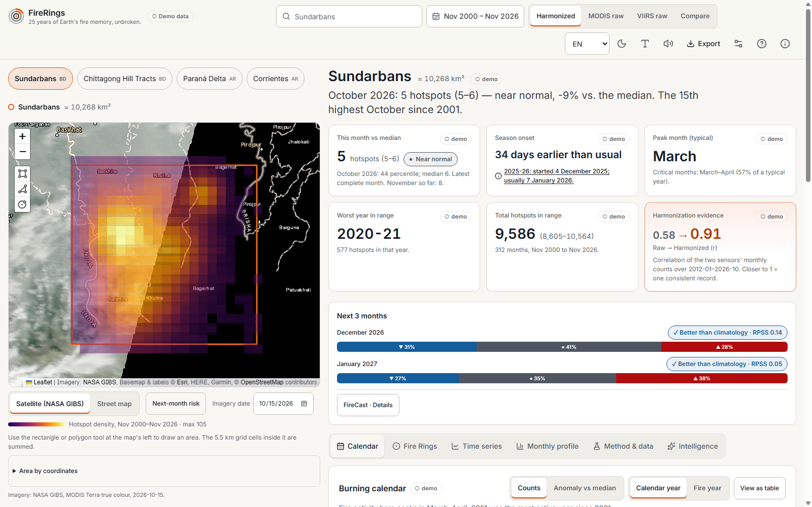

# FireRings — আগুন পঞ্জিকা (Agun Panjika) — Almanaque del Fuego

**25 years of Earth's fire memory, unbroken.**

**[▶ Open the live app](https://kajoldebnath01-firerings.static.hf.space/index.html?area=sundarbans)** · [Hugging Face Space](https://huggingface.co/spaces/kajoldebnath01/FireRings) · [Source code](https://github.com/SreeKajol/Nasa-Space-apps-challange) · Demo video: `[add YouTube link]` · Slides: `[add Google Drive link]`

NASA Space Apps 2026 · Challenge: *Harmonization of MODIS and VIIRS Hot Spots* · Team HalluciNation (Bangladesh)



> The live app currently runs on **demo data**: synthetic numbers, labelled `demo` on every card. Real NASA FIRMS data needs a free FIRMS key; see [Reproduce with real data](#reproduce-with-real-data).

## The problem

NASA has watched Earth's fires from space since 2000. MODIS (about 1 km pixels) runs from 2000, and the sharper VIIRS (375 m) from 2012. VIIRS sees many more small fires, so **a raw fire record jumps when VIIRS arrives**. That jump comes from a better sensor, not from more fires. Anyone reading the raw record, or any model trained on it, wrongly concludes that fires suddenly got worse.

## Our solution

FireRings joins MODIS and VIIRS into **one sensor-agnostic record from 2000 to today**, with an uncertainty band on every number. On that record, anyone can pick an area and a period and see:

- which months are critical, and when the fire season usually starts;
- which years were the worst;
- whether **this month** is unusual compared with the historical median;
- whether **this season started early**.

It speaks **English, বাংলা and Español**, works **offline**, can be **heard** as sound, **printed** as a one-page almanac, and downloaded as CSV.

## Try it in 60 seconds

| # | What to do | Live link |
| --- | --- | --- |
| 1 | **See the problem.** Raw MODIS and VIIRS side by side: the jump when VIIRS starts. | [Compare sensors](https://kajoldebnath01-firerings.static.hf.space/index.html?area=sundarbans&mode=compare&tab=series) |
| 2 | **See the fix.** Harmonized series with its uncertainty band. Press **Show the sensor break** to watch the raw lines merge into one. | [Harmonized time series](https://kajoldebnath01-firerings.static.hf.space/index.html?area=sundarbans&tab=series) |
| 3 | **Read the season.** Years × months calendar; click any month for details. | [Burning calendar](https://kajoldebnath01-firerings.static.hf.space/index.html?area=sundarbans) |
| 4 | **Watch 25 years.** Press play on the tree-ring chart. | [Fire Rings](https://kajoldebnath01-firerings.static.hf.space/index.html?area=sundarbans&tab=rings) |
| 5 | **Ask why.** ML explanations, 90% intervals and the FireCast outlook. | [Intelligence](https://kajoldebnath01-firerings.static.hf.space/index.html?area=sundarbans&tab=intel) |
| 6 | **For everyone.** The same view in Bangla; press the speaker icon to **hear the season**. | [বাংলা](https://kajoldebnath01-firerings.static.hf.space/index.html?lang=bn&area=sundarbans) |
| 7 | **Across the world.** Paraná Delta, Argentina, in Spanish. | [Español](https://kajoldebnath01-firerings.static.hf.space/index.html?lang=es&area=parana-delta&tab=rings) |
| 8 | **On paper.** One printable A4 page with a QR code back to the live view. | [Almanac](https://kajoldebnath01-firerings.static.hf.space/almanac/index.html?area=sundarbans) |

You can also draw your own area on the map (rectangle, polygon or pin + radius) or type `lat, lon` into the search box.

## Highlights

| | |
| --- | --- |
| **Science** | MODIS + VIIRS harmonized per region and calendar month on a 5.5 km grid. 90% uncertainty bands checked by leave-one-year-out validation. A Pettitt change-point test checks the 2012 seam before and after harmonization. |
| **Intelligence** | XGBoost explains *why* the sensors disagree, benchmarked against the ratio method. Conformal 90% intervals, TreeSHAP "Why this month?", and FireCast outlooks shown only where they beat climatology. No AI model writes any number. |
| **Inclusion** | English, বাংলা, Español. Sonification for blind users, screen-reader summaries and "View as table" on every chart, simple view, colour-blind-safe palette, printable almanac, offline PWA. |
| **Engineering** | Static site, no server, no keys. 47 frontend tests and 56 Python tests. Lighthouse mobile: performance ≥ 91, accessibility 100. Every view is a shareable URL. |

## NASA data used

| Source | What it gives FireRings |
| --- | --- |
| **FIRMS**: MODIS C6.1 and VIIRS 375 m active fires | The fire hotspots, 2000 to today |
| **POWER** | Monthly temperature, rainfall and humidity for each region |
| **EONET** | Independent wildfire events, used to check the calendar |
| **GIBS** | Satellite true-colour imagery under the map |

Full citations and DOIs: [Data citation](#data-citation).

## Team HalluciNation

| Name | Role |
| --- | --- |
| `[Name 1]` | Data pipeline |
| `[Name 2]` | Harmonization model |
| `[Name 3]` | Design and accessibility |
| `[Name 4]` | Front end |

Open source, Apache-2.0. **Not an official NASA product.** How AI coding assistants were used: [docs/AI_USE.md](docs/AI_USE.md).

## 30-second demo video plan

Every shot below shows a feature that exists in the app.

| Time | On screen | Voice / English subtitle |
| --- | --- | --- |
| 0:00–0:03 | Logo + "Team HalluciNation" | "We're Team HalluciNation from Bangladesh." |
| 0:03–0:07 | Compare view: raw records jump in 2012 | "NASA's fire records jump in 2012. Not more fires, just a new satellite." |
| 0:07–0:10 | Title card: FireRings · 25 years of Earth's fire memory, unbroken | "Meet FireRings." |
| 0:10–0:15 | Time series → **Show the sensor break**: the jump disappears | "We harmonize MODIS and VIIRS into one record, with uncertainty." |
| 0:15–0:20 | Sundarbans → calendar → "This month vs median" card | "Pick any area: see its fire season, worst years, and whether this month is unusual." |
| 0:20–0:24 | Switch to বাংলা → speaker icon → printable almanac | "In Bangla, English and Spanish, offline, even as sound." |
| 0:24–0:28 | Paraná Delta in Spanish; text: NASA FIRMS · POWER · EONET · GIBS | "Built on NASA open data, from Bangladesh to Argentina." |
| 0:28–0:30 | End card: FireRings + live link | "Fire history, for everyone." |

Rules: 30 seconds or less, English subtitles, no NASA logo, no one under 18, and the link must open without logging in.

## Run it

```sh
npm install
npm run dev        # http://localhost:5173
npm test           # 47 unit tests (statistics, adapters, data contract, i18n, URL state, ML layer, real-data snapshot)
npm run build      # typecheck + static build into dist/
npm run preview    # serve dist/ locally (service worker + offline mode active here)
```

The npm scripts call each tool through `node node_modules/...` instead of the bare `vite` / `tsc` commands. This is because the project folder name contains a `;`, which npm treats as a PATH separator. If you rename the folder, either form works.

`dist/` is a plain static site (no server, no keys) with relative paths. Put it on any static host, or serve it from a local folder.

## Data modes

| Mode | When | Badge |
| --- | --- | --- |
| **MockAdapter** (synthetic, generated in the browser) | default; no configuration | "Demo data" in the header, `demo` on every number block |
| **StaticJsonAdapter** (the pipeline's files) | `VITE_DATA_BASE_URL` is set at build time | `live`, or `cache` when served from a saved copy; the file's own `source` otherwise |
| **Real NASA data snapshot** | `public/data/index.json` has `"data_mode": "real"` (after `make snapshot`); detected at dev/build time | `cache` with the run's date; no "Demo data" badge. A preset without real data falls back to demo, labelled `demo` |

All data access goes through the single `DataProvider` interface (`src/data/types.ts`). Components never know which adapter is active. When `VITE_DATA_BASE_URL` is set, Settings also lets you switch back to the demo data.

To exercise the static path before the real pipeline exists, write the synthetic data as contract files:

```sh
npm run demo-data                              # → public/demo-data/ (git-ignored, ~2 MB)
VITE_DATA_BASE_URL=./demo-data npm run dev
```

The demo files keep `"source": "demo"`, so the app labels them honestly. Grid tiles are generated only around the Sundarbans preset, so custom areas drawn there work in static mode. Elsewhere you get the "no grid files" message.

## Reproduce with real data

```sh
cp .env.example .env          # then add your FIRMS_MAP_KEY (free: https://firms.modaps.eosdis.nasa.gov/api/map_key/)
pip install -r requirements-ml.txt -r requirements-ingest.txt   # venv OUTSIDE this folder (its name contains ';')
make real                     # = npm run real   (PYTHON=/path/to/venv/python)
make snapshot                 # = npm run snapshot: publish data-products/ to public/data/
npm run dev                   # the app now opens on the real data (badge: cache + run date)
```

- **`make fetch`** downloads into resumable caches under `data/raw/`; a re-run downloads nothing new. It covers NASA FIRMS hotspots (MODIS + the reference VIIRS satellite), NASA POWER monthly climate per region, and NASA EONET wildfire events.
  - `make fetch ARGS=--dry-run` prints the planned number of FIRMS calls.
  - FIRMS CSVs you already have go in `data/raw/archive/` and replace API calls for the dates they cover.
- **`make real`** chains fetch → clean / 5.5 km grid / harmonization (`src/compute/pipeline`) → contract files with the tested statistics (`scripts/export-contract.ts`) → ML layer → seam test → EONET check. It also writes `docs/data_report.md`.
- **Reference satellite.** Suomi-NPP stopped delivering on 1 Nov 2026, so the pipeline calibrates on NOAA-20 and `viirs_start` follows from FIRMS's own availability dates. Both are logged and shown in the Method tab.
- **Without a key,** FIRMS is skipped with a clear message and the previous snapshot (or the demo data) stays in place. Nothing is overwritten.
- **Settings:** `config/real_data.yaml` (regions, sources, chunking, rate limit, cache paths). Plan and decisions: [docs/real_data_plan.md](docs/real_data_plan.md).
- After `make snapshot` the site runs fully offline: every data file is local, and only map imagery needs the network.

## Data citation

- **NASA FIRMS.** We acknowledge the use of data and/or imagery from NASA's Fire Information for Resource Management System (FIRMS) (https://www.earthdata.nasa.gov/data/tools/firms), part of NASA's Earth Science Data and Information System (ESDIS). Products:
  - MODIS Collection 6.1 active fire detections (MCD14ML; MCD14DL NRT, doi:10.5067/FIRMS/MODIS/MCD14DL.NRT.0061)
  - VIIRS 375 m active fire detections:
    - Suomi-NPP VNP14IMG (doi:10.5067/FIRMS/VIIRS/VNP14IMGT_NRT.002)
    - NOAA-20 VJ114IMG (doi:10.5067/FIRMS/VIIRS/VJ114IMGT_NRT.002)
    - NOAA-21 VJ214IMG (doi:10.5067/FIRMS/VIIRS/VJ214IMGT_NRT.002)
- **NASA POWER.** These data were obtained from the NASA Langley Research Center (LaRC) POWER Project funded through the NASA Earth Science/Applied Science Program.
- **NASA EONET.** Natural event data from the NASA Earth Observatory Natural Event Tracker (EONET), API v3.
- **NASA GIBS.** We acknowledge the use of imagery provided by services from NASA's Global Imagery Browse Services (GIBS), part of NASA's Earth Science Data and Information System (ESDIS).

Access dates of each run are recorded in `index.json` (`access`). They appear with the citation in the Method & data tab and in `docs/data_report.md`.

## Data contract — what the app assumes beyond the brief

The contract in the brief is implemented exactly (`src/data/types.ts`). Where it was silent, the app assumes the following. Please confirm these against the pipeline:

- **Grid tile ids** are `{lat0}_{lon0}`: the south-west corner, floored to `grid.tile_deg`, e.g. `grid/22_88.json`. A missing tile (404) means no fire cells were recorded there.
- **Months missing from a cell's `m`** count as zero.
- **The current month is partial** when `last_month` equals the current UTC month. It is drawn hatched, is excluded from history statistics, and `current` refers to the latest complete month.
- **`onset` may be `null`** when the current season has not crossed its threshold yet.
- **`validation` is absent for custom areas.** The app says so instead of borrowing a preset's numbers.
- **Custom areas** take their fire-year start month from the nearest preset in the same hemisphere.
- **SPA fallbacks** (a static host answering a missing `.json`/`.csv` with `index.html`) are treated as "file missing".
- **Coefficients CSV:** the contract has no fitted coefficients, so the CSV holds *effective* harmonized ÷ raw ratios per calendar month over the overlap, derived from the published series, and it says so.

## What's in the app

- **Top bar:** area search (preset names or `lat, lon` → 10 km pin), month-precision date range, sensor control **Harmonized | MODIS raw | VIIRS raw | Compare**, language (EN / বাংলা / ES), theme, simple view, Hear the season, Export, Settings, Help/About.
- **Map (left, lazy-loaded):**
  - NASA GIBS MODIS Terra true colour with an explicit date (it follows the open month), or the keyless Esri light/dark canvas.
  - Hotspot-density layer from grid cells for the selected range.
  - Draw rectangle / polygon / pin + radius (Geoman), plus a coordinates form for keyboard users.
- **KPI cards:** this month vs median, season onset (click → explainer with a cumulative chart), peak month, worst year, total in range, and the harmonization evidence (raw r → harmonized r).
  - **Simple view** swaps these for three big icon cards.
  - The **3-month outlook** card shows only months with RPSS > 0, each with its skill badge; otherwise it shows "No reliable outlook for this area."
- **Tabs:**
  - **Calendar:** years × months with marginal medians and yearly totals, counts / anomaly view, calendar or fire years, ⚠ extremes, keyboard grid, month drawer.
  - **Fire Rings:** radial tree-ring chart with a 6 s play animation.
  - **Time series:** uncertainty band, brush zoom, 12-month mean, NASA POWER context strip, and **Show the sensor break** (raw lines morph into the harmonized line in under 2 s).
  - **Monthly profile**
  - **Method & data:** steps, validation, parameters, before/after seam, why now, sources, limitations, downloads.
- **Hotspot table:** virtualized and sortable, with CSV download.
- **Printable almanac** at `almanac/`: one black-and-white-safe A4 page with a QR code back to the live view.
- **Offline / PWA:** the service worker precaches the app shell. Data files are cached network-first and labelled `cache` when offline, with the offline banner showing the save date. Map tiles are cached up to 800.
- **Accessibility:**
  - Every chart has a one-line `aria-live` summary and "View as table".
  - Status always shows icon + word (▼ ● ▲ ⚠).
  - 44 px targets, visible focus rings, "Skip to calendar", reduced-motion support, AA contrast tokens in both themes, cividis option.
  - Sonification ("Hear the season") with per-note announcements, and a first-visit 3-step tour.

Every shareable setting lives in the URL, for example:
`?lang=bn&area=parana-delta&from=2015-01&mode=viirs&tab=rings&view=anomaly&rows=fire&m=2020-08`.

## FireRings Intelligence (ML layer)

An additive layer on top of the app. If its files are missing, the app behaves exactly as before.

- **ML harmonization.** XGBoost learns *why* MODIS and VIIRS disagree, benchmarked against the stratified ratio method.
- **Conformal 90% intervals.** Coverage is checked per land cover, country and activity level.
- **TreeSHAP explanations.** Global drivers, plus a "Why this month?" waterfall in the month drawer.
- **FireCast.** Below / near / above-normal outlooks, shown only where hindcasts beat climatology.
- **Grounded narratives.** Templates in EN/BN/ES; no model writes a number.
- **Demo moment.** "Train on raw vs harmonized" shows the fake jump that raw-trained AI learns when VIIRS arrives.

```sh
pip install -r requirements-ml.txt   # CPU only; use a venv OUTSIDE this folder (its name contains ';')
npm run ml                           # = make ml: demo inputs if no pipeline files, then train,
                                     #   validate, explain, forecast, export -> public/data/ml/
python -m pytest tests/ml -q         # leakage, conformal coverage, scores, schema, determinism
```

- **Real data.** The pipeline writes `data-products/index.json`, `region/*.json` and `ml_inputs/cell_month.parquet` (schema in [docs/ml_features.md](docs/ml_features.md)).
- **Demo data.** The demo exporter dumps the browser demo's cell field. The ML layer simulates sensor observations on it, and every output is labelled `demo`.
- **Further reading.**
  - Method and validation table: [docs/ml_method.md](docs/ml_method.md)
  - Plans: [docs/ml_plan.md](docs/ml_plan.md), [docs/ml_frontend_plan.md](docs/ml_frontend_plan.md)
  - AI-use log: [docs/AI_USE.md](docs/AI_USE.md)

## Code map

```
src/compute/derive.ts      statistics: percentiles, climatology, onset, geometry (tested)
src/data/types.ts          data contract + DataProvider interface
src/data/mock.ts           MockAdapter — deterministic synthetic cell field
src/data/staticJson.ts     StaticJsonAdapter — pipeline files, cache fallback
src/data/view.ts           sensor modes, year rows, totals (all charts read through this)
src/i18n/{en,bn,es}.json   every UI string; summaries are templates with {placeholders}
src/state/                 URL state, device preferences, app context
src/components/            shell, top bar, KPIs, drawers, map, charts (D3), method tab
src/almanac/               printable A4 page (second Vite entry: almanac/index.html)
src/ingest/                real NASA data: FIRMS (availability, plan, cache, normalize), POWER, EONET
src/compute/pipeline/      real-data clean -> 5.5 km grid -> harmonization -> contract stage
src/compute/seam.py        sensor-break (Pettitt) test; src/compute/data_report.py: docs/data_report.md
src/compute/ml/            Python ML layer: features, harmonize_ml, conformal, explain, firecast, narrative, run
src/ml/                    ML frontend: MLProvider (static + mock), Intelligence tab, drawer section, risk layer
tests/ml/                  Python tests for the ML layer
tests/ingest/              Python tests for ingest, pipeline, seam (no network)
public/sw.js               service worker
scripts/generate-demo-data.ts
```

## Before submission — placeholders to fill

- Demo video and slides links: the link line at the top of this README
- Team member names: the "Team HalluciNation" table in this README, and `AboutDialog` in `src/components/TopBar.tsx`
- Repository URL: same dialog
- Method PDF URL: `METHOD_PDF` in `src/components/MethodTab.tsx`
- `m.p_conf_v` ("MODIS ≥ 30%; VIIRS nominal or high") in `src/i18n/*.json` matches the real pipeline's filter (`config/real_data.yaml` → `clean`); keep them in sync if you change it

## Performance

On a mobile Lighthouse run (production build, Edge), every page tested scores performance ≥ 91, accessibility 100 and best practices 100. Details are in [docs/CHECKLIST.md](docs/CHECKLIST.md). What makes that possible:

- A static loading shell in `index.html` paints immediately, and the stylesheet doesn't block it.
- First-load JS is about 161 KB gzipped. Bangla/Spanish, the four secondary tabs, and (on phones) the map load on demand.
- The first render and the calendar are time-sliced with React transitions.

## Known limits

- **Demo data is synthetic.** Its validation numbers are generated to the brief's targets (r ≈ 0.6 → 0.9) and are not measured.
- **NASA GIBS MODIS Terra imagery** has daily swath gaps. Pick another imagery date if a day looks patchy.
- **Inter font file names are hashed by the build**, so they can't be preloaded from `index.html`. The loading shell uses system fonts on purpose.
